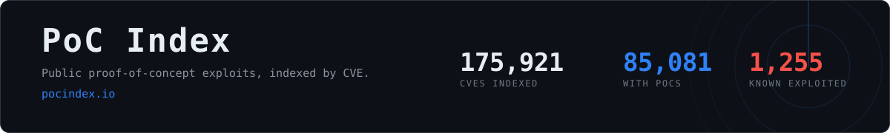

<div align="center">

<a href="https://pocindex.io/"></a>

[](https://github.com/0xMarcio/pocindex/commits/main)&nbsp;[](https://github.com/0xMarcio/pocindex/actions/workflows/hot_cves.yml)&nbsp;[](https://pocindex.io/)&nbsp;[](https://pocindex.io/)&nbsp;[](https://github.com/0xMarcio/pocindex/stargazers)

<a href="https://pocindex.io/"></a>

</div>

**[PoC Index](https://pocindex.io/)**: Search public CVE proof-of-concept exploits from GitHub, Nuclei, ExploitDB, Metasploit and Vulhub, with CVSS, EPSS and CISA KEV context. Find exploits by CVE, vendor, product or keyword. Compare CVSS severity, EPSS exploitation scores and CISA known-exploited status.

## Just landed

| Repo stars | Released | PoC | Description |
| --- | --- | --- | --- |
| 1⭐ | 4h ago | [Fold7-Canada-TempRoot-Lock](https://github.com/username-enzo/Fold7-Canada-TempRoot-Lock) | In the Linux kernel, the following vulnerability has been resolved: xfrm: esp: avoid in-place decrypt on… |
| 0⭐ | 5h ago | [poc-CVE-2026-0073](https://github.com/xqi1337/poc-CVE-2026-0073) | In adbd_tls_verify_cert of auth.cpp, there is a possible bypass of wireless ADB mutual authentication due to… |
| 0⭐ | 5h ago | [CVE-2026-119618](https://github.com/LLCForge/CVE-2026-119618) | Weaponised PoC driver for CVE-2026-119618, the mod_http2 assign_headers() race: header-table shaping,… |
| 0⭐ | 7h ago |  [CVE-2026-56290](https://github.com/Mushr00w/CVE-2026-56290) | Exploit for CVE-2026-56290 - Joomla Page Builder CK <= 3.5.10 Unauthenticated RCE. For educational and… |
| 0⭐ | 8h ago | [CVE-2026-12413-libreswan-poc](https://github.com/Mohammad-Jafar-Shabib/CVE-2026-12413-libreswan-poc) | First public PoC for CVE-2026-12413 - libreswan IKEv2 fragment off-by-one (unauthenticated remote DoS, fixed… |
| 0⭐ | 9h ago | [cve-2026-119618-Apache](https://github.com/geovanidps/cve-2026-119618-Apache) | Concurrent Execution using Shared Resource with Improper Synchronization vulnerability in Apache HTTP… |
| 0⭐ | 10h ago |  [cve-2026-34621-poc](https://github.com/dexteon/cve-2026-34621-poc) | Research notes for cve-2026-34621-poc |
| 0⭐ | 10h ago | [CVE-ARFORMS](https://github.com/im0xfay/CVE-ARFORMS) | ARForms unauth file upload → RCE PoCs (CVE-2026-111190 / 12424 / 12427) - ARForms 7.x + 6.x, docker lab,… |
| 0⭐ | 10h ago | [CVE-2026-126537](https://github.com/im0xfay/CVE-2026-126537) | CVE-2026-126537 - Ninja Forms File Uploads <= 3.3.36: unauthenticated arbitrary file deletion/read via… |
| 0⭐ | 11h ago |  [cve-2023-26369-poc](https://github.com/dexteon/cve-2023-26369-poc) | Research notes for cve-2023-26369-poc |

## Trending in 2026

| Repo stars | Updated | Repository | Description |
| --- | --- | --- | --- |
| 126⭐ | 2d ago | [root-my-s24](https://github.com/NanoTurtle1145/root-my-s24) | Using CVE-2026-43499/CVE-2026-98260 to root your Galaxy S24 Series(SM-S92X0 ,(China / Hong Kong SAR / Taiwan)) |
| 383⭐ | 22d ago | [CVE-2026-9830](https://github.com/opaxial/CVE-2026-9830) | CVE-2026-9830 Proof of Concept |
| 505⭐ | 66d ago | [Root-My-Pixel](https://github.com/alex193a/Root-My-Pixel) | Jailbreak supported Google Pixel phones with CVE-2026-43499 |
| 41⭐ | 6h ago |  [CVE-2026-111497-PoC](https://github.com/MchinaMd57764/CVE-2026-111497-PoC) | A buffer overflow vulnerability in the Brotli decoder (c/dec/decode.c) in Google Brotli versions 1.0.3… |
| 292⭐ | 41d ago | [KSuRoot](https://github.com/hmascs/KSuRoot) | KSuRoot 4.0.0 - 基于 CVE-2026-43499(GhostLock) 的一键 KernelSU 提权工具。多内核支持：6.1 / 6.6 / 6.12 三族各有专属基线，另有 50… |
| 71⭐ | 5d ago | [portal-root-kiosk-satellite](https://github.com/jxlarrea/portal-root-kiosk-satellite) | Root and provisioning for Meta Portal devices for optimal use with Kiosk Satellite. |
| 154⭐ | 19d ago |  [php2shell](https://github.com/syrex1013/php2shell) | CVE-2026-109618/109619 PoC - PHP session.upload_progress heap use-after-free (CVSS 9.2) |
| 60⭐ | 20h ago | [CVE-2026-112611](https://github.com/Rust505/CVE-2026-112611) | CVE-2026-112611: OOB Write in CoreGraphics (PDF ShadingType 5) via /N and /C0 array mismatch. Causes heap… |
| 115⭐ | 23d ago |  [php-cve-2026-10961x-lab-poc](https://github.com/dinosn/php-cve-2026-10961x-lab-poc/blob/eb8558b04a1bbbd85d2b3a7a64780ab17cccc951/scripts/reproduce.py) | PHP CVE-2026-109618/109619 - self-contained unauthenticated RCE on stock PHP 8.5.11 (in-band PS(id)→cookie… |
| 99⭐ | 21d ago |  [PHP2Shell-Full-Chain-Exploit](https://github.com/78ResearchLab/PHP2Shell-Full-Chain-Exploit) | PHP uses longjmp() for out-of-memory (OOM) errors to exit the current context and abort handling of the… |
| 64⭐ | 11d ago |  [TrustedHive](https://github.com/dis0rder0x00/TrustedHive) | LPE Proof-of-Concept for Windows 11 abusing TrustedInstaller's Component Based Servicing (CBS) session COM… |
| 107⭐ | 25d ago |  [plex2shell](https://github.com/code-zm/plex2shell) | Plex Media Server before 1.43.3.10861 allows SSRF via '/player/timeline'. An attacker using any X-Plex-Token… |
| 78⭐ | 14d ago | [CVE-2026-97798-exploit](https://github.com/G4sp4rCS/CVE-2026-97798-exploit) | CVE-2026-97798 Windows Error Reporting - Command Injection TO SYSTEM |
| 32⭐ | 4d ago | [CVE-2026-126187-poc](https://github.com/briskets/CVE-2026-126187-poc) | CVE-2026-126187 Unauthenticated RCE in React Server Components - PoC and Docker lab for GHSA-xqc2-xf4c-x3h3 /… |
| 108⭐ | 31d ago | [IonStack-S22U](https://github.com/sarabpal-dev/IonStack-S22U) | CVE-2026-43499 full exploit chain for Samsung Galaxy S22 Ultra (Android 5.10 kernel) |
| 83⭐ | 21d ago |  [actual-php2shell](https://github.com/the-cookie-bakery/actual-php2shell) | :robot: (Vibecoded prototype) NO, There is an easy way to exploit this vulnerability! |
| 81⭐ | 19d ago |  [CVE-2026-111497-POC](https://github.com/dimasma0305/CVE-2026-111497-POC) | Reproducible local Brotli decoder proof for CVE-2026-111497 with a self-checking tuned RCE harness |
| 95⭐ | 28d ago | [GhostSam](https://github.com/snothin/GhostSam) | Samsung temp root tool (until reboot) - Ghostlock / dirtyfrag exploit chains + manager app. |
| 194⭐ | 82d ago | [CVE-2026-62911](https://github.com/hypnguyen1209/CVE-2026-62911) | POC pre-auth RCE on Exchange |
| 60⭐ | 12h ago | [CVE-2026-98260](https://github.com/woshigenm/CVE-2026-98260) | Android LPE (CVE-2026-98260) on Honor MagicPad3 Pro 13.3 (YLP-W00), kernel 6.12.38 - PoC/EXP, uid-0 shell,… |

## Trending in 2025

| Repo stars | Updated | Repository | Description |
| --- | --- | --- | --- |
| 569⭐ | 20d ago | [samsung-tv-root](https://github.com/chris-ritsen/samsung-tv-root) | Samsung Tizen root |
| 141⭐ | 11d ago | [unisoc-su](https://github.com/Skorpion96/unisoc-su) | A method for CVE-2025-31710 and to connect to cmd_skt to obtain a root shell on unisoc unpatched models |
| 719⭐ | 37d ago |  [CVE-2025-33073](https://github.com/mverschu/CVE-2025-33073) | PoC Exploit for the NTLM reflection SMB flaw. |
| 250⭐ | 73d ago | [BitUnlocker](https://github.com/garatc/BitUnlocker) | Downgrade attack for CVE-2025-48804 |
| 10⭐ | 4d ago |  [ABrake27](https://github.com/vvirei333/ABrake27) | iOS 27 kernelcache RE: SEP dispatch map, AMFI diff, Ghidra workflow. |
| 30⭐ | 61d ago | [Douglas-Guidebook](https://github.com/douglasmun/Douglas-Guidebook) | Douglas Mun's Technical Guidebooks |
| 12⭐ | 77d ago |  [vivo_iqoo_neo_9_root_research_on_CVE-2025-21479](https://github.com/linux-tools/vivo_iqoo_neo_9_root_research_on_CVE-2025-21479) | Memory corruption due to unauthorized command execution in GPU micronode while executing specific sequence of… |
| 3⭐ | 7d ago | [CVE-2025-9974](https://github.com/Rajdave69/CVE-2025-9974) | Proof of Concept code for the CVE-2025-9974 affecting Nokia Beacon routers. |
| 8⭐ | 57d ago | [MSRMapper](https://github.com/uLl0a/MSRMapper) | MSRMapper is a manual kernel driver mapper for Windows x64 that abuses CVE-2025-8061 in the vulnerable Lenovo… |
| 8⭐ | 57d ago |  [CVE-2025-32432-exploit-by-P34NUT](https://github.com/P34NUT2/CVE-2025-32432-exploit-by-P34NUT) | Reliable CVE-2025-32432 pre-auth RCE exploit for Craft CMS 3.x/4.x/5.x, works where other public PoCs fail |
| 5⭐ | 31d ago |  [CVE-2025-8110](https://github.com/Ghxstsec/CVE-2025-8110) | PoC for CVE-2025-8110 - authenticated RCE in Gogs via symlink bypass in PutContents API (Metasploit PR #22115) |
| 7⭐ | 85d ago |  [cve-2025-21479_iqooneo8](https://github.com/Qingizi7/cve-2025-21479_iqooneo8) | Local root exploit for CVE-2025-21479 (Adreno KGSL) on iQOO Neo8 (SM8475) - physical memory r/w, disables… |
| 3⭐ | 29d ago | [CVE-2025-41450_poc](https://github.com/Nero22k/CVE-2025-41450_poc) | Improper Authentication vulnerability in Danfoss AKSM8xxA Series.This issue affects Danfoss AK-SM 8xxA Series… |
| 3⭐ | 46d ago |  [CVE-2025-21479-FX5P](https://github.com/diyiqiuye/CVE-2025-21479-FX5P) | Temporary root for OPPO Find X5 Pro (PFEM00) via CVE-2025-21479 + KernelSU LKM late-load (cloud-buildable) |
| 4⭐ | 77d ago |  [CVE-2025-3248-Langflow-RCE](https://github.com/hideki233/CVE-2025-3248-Langflow-RCE) | Langflow versions prior to 1.3.0 are susceptible to code injection in the /api/v1/validate/code endpoint. A… |
| 4⭐ | 87d ago |  [vivo_iqoo_neo_9_root_research_on_CVE-2025-21479](https://github.com/reaizuguo/vivo_iqoo_neo_9_root_research_on_CVE-2025-21479) | iQOO Neo9 (PD2338C) 免解锁 Caps-Root 工具** - 基于 CVE-2025-21479 (Adreno GPU SDS) 的任意物理写提权方案 |
| 5⭐ | 17d ago |  [CVE-2025-52691-APT-PoC](https://github.com/DeathShotXD/CVE-2025-52691-APT-PoC) | An enhanced proof-of-concept exploit for CVE-2025-52691 (SmarterMail Arbitrary File Upload RCE) with… |

<details>
<summary>2024, 2023, 2022</summary>

## Trending in 2024

| Repo stars | Updated | Repository | Description |
| --- | --- | --- | --- |
| 18⭐ | 40d ago | [CVE-2024-56426](https://github.com/Creeeeger/CVE-2024-56426) | A PoC of the CVE-2024-56426 vulnerability. |
| 3⭐ | 7d ago | [cve-2024-26229-bof](https://github.com/stillbigjosh/cve-2024-26229-bof) | Beacon Object File that exploits the Windows CSC (Client-Side Caching) driver for local privilege escalation. |

## Trending in 2023

| Repo stars | Updated | Repository | Description |
| --- | --- | --- | --- |
| 161⭐ | 26d ago |  [Trigon](https://github.com/alfiecg24/Trigon) | Deterministic kernel exploit based on CVE-2023-32434. |
| 3⭐ | 5d ago | [CVE-2023-6241-JM](https://github.com/R0rt1z2/CVE-2023-6241-JM) | CVE-2023-6241 (kbase_jit_free race) PoC |
| 9⭐ | 39d ago |  [picohaxx](https://github.com/264312431/picohaxx) | A kernel exploit for Pico 4 devices based on cve-2023-33107. |
| 3⭐ | 51d ago | [cve-2023-6931-pipa](https://github.com/Yutori-Natsu/cve-2023-6931-pipa) | A heap out-of-bounds write vulnerability in the Linux kernel's Performance Events system component can be… |

## Trending in 2022

| Repo stars | Updated | Repository | Description |
| --- | --- | --- | --- |
| 7⭐ | 35d ago | [CVE-2022-22077](https://github.com/grisuno/CVE-2022-22077) | CVE-2022-22077 is a high-severity vulnerability (CVSS score 7.8) affecting the RTCore64.sys driver… |

</details>

## Data

Every file is plain JSON on the CDN. No key, no rate limit.

```bash
# everything the index knows about one CVE
curl -s https://pocindex.io/CVE_list.json \
  | jq '.[] | select(.cve == "CVE-2021-44228") | {cve, poc: (.poc | length), nuclei, msf, edb, vulhub, collections}'

# every published CVSS assessment plus vetted advisory links
curl -s https://pocindex.io/cve_metadata.json | jq '."CVE-2021-44228"'

# likelihood of exploitation in the next 30 days
curl -s https://pocindex.io/epss.json | jq '."CVE-2021-44228"'

# stars and last push for one PoC repository; repository keys are lowercased
curl -s https://pocindex.io/repo_meta.json | jq '."sfewer-r7/cve-2026-55040"'
```

What CISA says is being exploited, that also has a PoC here, ranked by how
likely each is to be used next:

```bash
curl -s https://pocindex.io/kev.json  -o kev.json
curl -s https://pocindex.io/epss.json -o epss.json
jq -n --slurpfile kev kev.json --slurpfile epss epss.json \
  '[$kev[0] | keys[] | select($epss[0][.]) | {cve: ., epss: $epss[0][.][0]}]
   | sort_by(-.epss) | .[:10]'
```

| Endpoint | Holds |
| --- | --- |
| [`CVE_list.json`](https://pocindex.io/CVE_list.json) | Every CVE with a linked PoC, its description and its `poc`, `nuclei`, `msf`, `edb`, `vulhub` and `collections` links |
| [`cve_metadata.json`](https://pocindex.io/cve_metadata.json) | CVSS v2.0, v3.0, v3.1 and v4.0 assessments from NVD and the CVE Program, with vectors and vetted advisory links |
| [`epss.json`](https://pocindex.io/epss.json) | Exploitation probability and percentile, for nearly every CVE indexed |
| [`nuclei.json`](https://pocindex.io/nuclei.json) | Template metadata for the CVEs covered by a runnable Nuclei check |
| [`kev.json`](https://pocindex.io/kev.json) | CISA known exploited, keyed by CVE id |
| [`repo_meta.json`](https://pocindex.io/repo_meta.json) | Stars and last push date per PoC repository, keys lowercased |
| [`trending_poc.json`](https://pocindex.io/trending_poc.json) | Two independent lists in display order, `landed` by first release and `items` for Trending, plus index totals |
| [`cves/2026/CVE-2026-68138.md`](cves/2026/CVE-2026-68138.md) | Markdown copy of one CVE, one directory per year |

CVSS rows are `[version, score, severity, vector, source, assessment type]`.
Advisory rows are `[URL, NVD reference tags]`.
Repository metadata rows are `[stars, last_push_UTC_date]`. Repo stars describe
the hosting GitHub repository, including links to individual files. `N/A`
means that no public repository reading is available; a measured zero is `0`.
`published` is the CVE record publication date. When it is unavailable,
`poc_observed` records the earliest retained observation of a listed PoC.
Newest uses that fallback and labels it separately as “PoC observed”.

## Sources

Public PoCs are indexed as soon as they pass source checks. CVE and NVD metadata
enrich the listing when available; pending CVE records do not hide PoC links.

| Source | What it contributes |
| --- | --- |
| GitHub | Repositories naming a CVE, checked for code before they are linked |
| [PoC-in-GitHub](https://github.com/nomi-sec/PoC-in-GitHub) | Historical repository candidates, passed through the same code and intent checks |
| [Nuclei](https://github.com/projectdiscovery/nuclei-templates) | Runnable templates that exercise the vulnerability |
| [ExploitDB](https://gitlab.com/exploit-database/exploitdb) | Archived exploits, mapped by their own CVE column |
| [Metasploit](https://github.com/rapid7/metasploit-framework) | Modules, best ranked first |
| [Vulhub](https://github.com/vulhub/vulhub) | Runnable vulnerable environments and reproduction steps |
| [afrog](https://github.com/zan8in/afrog), [Vulnerability](https://github.com/tzwlhack/Vulnerability), [0day](https://github.com/helloexp/0day), [xray](https://github.com/chaitin/xray), [Google Security Research](https://github.com/google/security-research), [GitHub Security Lab](https://github.com/github/securitylab), [Rhino Security Labs](https://github.com/RhinoSecurityLabs/CVEs), [Tenable](https://github.com/tenable/poc), [pedrib](https://github.com/pedrib/PoC) | CVE-specific templates, code and reproduction guides inside multi-CVE repositories |
| [Openwall](https://www.openwall.com/lists/), [SecLists](https://seclists.org/) and [Gist](https://gist.github.com/) | Reproducers from disclosure posts and Gists that NVD references, linked only after review |
| [EPSS](https://www.first.org/epss/) | Daily exploitation probability from FIRST |
| [CISA KEV](https://www.cisa.gov/known-exploited-vulnerabilities-catalog) | What is being exploited in the wild |
| [NVD](https://nvd.nist.gov/) | CVSS assessments and tagged vendor, third-party, patch and mitigation references |
| [CVE Program](https://www.cve.org/) | The CVE record, publication state and CNA references |

## Build

| Job | Cadence | Picks up |
| --- | --- | --- |
| [Trending sweep](.github/workflows/hot_cves.yml) | hourly | Front-page repositories, new repository metadata, a rotating refresh of older repositories and CVE Program scores received during discovery |
| [CVE sync](.github/workflows/sync_cve_pocs.yml) | daily | New CVEs, CNA references and recently pushed GitHub repositories for every CVE year |
| [Metadata sync](.github/workflows/sync_metadata.yml) | daily plus weekly full pass | CVSS, advisories, rejected records, current CISA KEV status and reviewed Gist and mailing list reproducers |
| [Nuclei sync](.github/workflows/sync_nuclei.yml) | daily | New templates and rating changes |
| [Exploit archives](.github/workflows/sync_exploits.yml) | daily | ExploitDB, Metasploit and Vulhub mappings |
| [Historical GitHub sync](.github/workflows/sync_pocingithub.yml) | daily | Older PoC repositories missed by the recent-push window |
| [Path collection sync](.github/workflows/sync_collections.yml) | every 6 hours | CVE-specific artifacts inside curated multi-CVE repositories |
| [Link audit](.github/workflows/audit_poc_links.yml) | daily | Repositories that went dead, dropped from the index |

## Contributing

Missing PoC, wrong link, dead repository: open an issue with the CVE id and the
repository URL.
