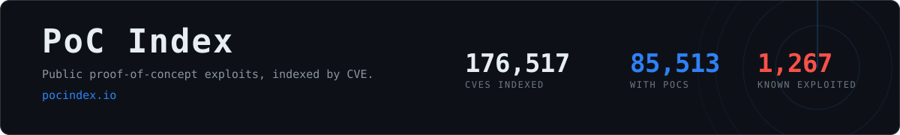

<div align="center">

<a href="https://pocindex.io/"></a>

[](https://github.com/0xMarcio/pocindex/commits/main)&nbsp;[](https://github.com/0xMarcio/pocindex/actions/workflows/hot_cves.yml)&nbsp;[](https://pocindex.io/)&nbsp;[](https://pocindex.io/)&nbsp;[](https://github.com/0xMarcio/pocindex/stargazers)

<a href="https://pocindex.io/"></a>

</div>

**[PoC Index](https://pocindex.io/)**: Search public CVE proof-of-concept exploits from GitHub, Nuclei, ExploitDB, Metasploit and Vulhub, with CVSS, EPSS and CISA KEV context. Find exploits by CVE, vendor, product or keyword. Compare CVSS severity, EPSS exploitation scores and CISA known-exploited status.

## Just landed

| Repo stars | Released | PoC | Description |
| --- | --- | --- | --- |
| 0⭐ | 32m ago | [CVE-2026-130848](https://github.com/yingcaipro-cmd/CVE-2026-130848) | CVE-2026-130848 Dolibarr Website import code injection - write-up + PoC |
| 0⭐ | 33m ago | [CVE-2026-130847](https://github.com/yingcaipro-cmd/CVE-2026-130847) | CVE-2026-130847 Dolibarr Users API improper authorization - write-up + PoC |
| 0⭐ | 40m ago |  [CVE-2026-129448](https://github.com/evenomn/CVE-2026-129448) | Deserialization of Untrusted Data in Apache Roller versions 4.0.0 through 6.1.4 allows an unauthenticated… |
| 0⭐ | 1h ago | [emuddler](https://github.com/shaofeihuang/emuddler) | Proof-of-concept tool for recovering EC private keys affected by the October 2026 eMudhra intermediate CA key… |
| 0⭐ | 1h ago |  [ASM-1-Security-in-Computing](https://github.com/Yixi050208/ASM-1-Security-in-Computing) | Gladinet CentreStack through 16.1.10296.56315 (fixed in 16.4.10315.56368) has a deserialization vulnerability… |
| 0⭐ | 5h ago | [CVE-2026-14914](https://github.com/LLCForge/CVE-2026-14914) | Tegsoft Unrestricted File Upload RCE |
| 0⭐ | 6h ago | [CVE-2026-129039](https://github.com/LLCForge/CVE-2026-129039) | Tribulant Newsletters WordPress Deserialization RCE |
| 0⭐ | 6h ago | [CVE-2026-120539](https://github.com/LLCForge/CVE-2026-120539) | BuddyPress < 1.5.5 Unauthenticated RCE |
| 0⭐ | 7h ago | [CVE-2026-123633-PoC](https://github.com/Nexxus67/CVE-2026-123633-PoC) | Reproducible NGINX HTTP/2 use-after-free PoC (CVE-2026-123633) with AddressSanitizer and patched-version… |
| 0⭐ | 8h ago | [CVE-2026-99320](https://github.com/ZZ2266/CVE-2026-99320) | StaleRoute: CVE-2026-99320 - The Route VRF Left Behind. rawv6 VRF dst UAF exploit, writeup and Docker… |

## Trending in 2026

| Repo stars | Updated | Repository | Description |
| --- | --- | --- | --- |
| 280⭐ | 3d ago | [CVE-2026-123007](https://github.com/sfewer-r7/CVE-2026-123007) | Proof-of-concept (PoC) scripts for CVE-2026-123007, an integer underflow in NGINX HTTP/2. |
| 144⭐ | 23h ago | [root-my-s24](https://github.com/NanoTurtle1145/root-my-s24) | Using CVE-2026-43499/CVE-2026-98260 to root your Galaxy S24 Series(SM-S92X0 ,(China / Hong Kong SAR / Taiwan)) |
| 519⭐ | 74d ago | [Root-My-Pixel](https://github.com/alex193a/Root-My-Pixel) | Jailbreak supported Google Pixel phones with CVE-2026-43499 |
| 46⭐ | 1d ago | [CVE-2026-112477](https://github.com/Rust505/CVE-2026-112477) | CVE-2026-112477 - Use-After-Free (UAF) in the `IOSurfaceRootUserClient` surface registry (iOS): a race… |
| 296⭐ | 50d ago | [KSuRoot](https://github.com/hmascs/KSuRoot) | KSuRoot 4.0.0 - 基于 CVE-2026-43499(GhostLock) 的一键 KernelSU 提权工具。多内核支持：6.1 / 6.6 / 6.12 三族各有专属基线，另有 50… |
| 116⭐ | 6d ago | [CVE-2026-112611](https://github.com/Rust505/CVE-2026-112611) | CVE-2026-112611: OOB Write in CoreGraphics (PDF ShadingType 5) via /N and /C0 array mismatch. Causes heap… |
| 154⭐ | 28d ago |  [php2shell](https://github.com/syrex1013/php2shell) | CVE-2026-109618/109619 PoC - PHP session.upload_progress heap use-after-free (CVSS 9.2) |
| 75⭐ | 14d ago | [portal-root-kiosk-satellite](https://github.com/jxlarrea/portal-root-kiosk-satellite) | Root and provisioning for Meta Portal devices for optimal use with Kiosk Satellite. |
| 17⭐ | 22h ago | [Time-My-Galaxy](https://github.com/MocLG/Time-My-Galaxy) | CVE-2026-98260 timerfd exploit and Shizuku launcher for the Samsung |
| 117⭐ | 31d ago |  [php-cve-2026-10961x-lab-poc](https://github.com/dinosn/php-cve-2026-10961x-lab-poc/blob/eb8558b04a1bbbd85d2b3a7a64780ab17cccc951/scripts/reproduce.py) | PHP CVE-2026-109618/109619 - self-contained unauthenticated RCE on stock PHP 8.5.11 (in-band PS(id)→cookie… |
| 31⭐ | 4d ago | [GhostLock-H80GT](https://github.com/yakidango-official/GhostLock-H80GT) | Honor 80 GT privilege escalation PoC: GhostLock (CVE-2026-43499) + custom KernelSU module loading |
| 51⭐ | 8d ago |  [CVE-2026-111497-PoC](https://github.com/MchinaMd57764/CVE-2026-111497-PoC) | A buffer overflow vulnerability in the Brotli decoder (c/dec/decode.c) in Google Brotli versions 1.0.3… |
| 103⭐ | 30d ago |  [PHP2Shell-Full-Chain-Exploit](https://github.com/78ResearchLab/PHP2Shell-Full-Chain-Exploit) | PHP uses longjmp() for out-of-memory (OOM) errors to exit the current context and abort handling of the… |
| 32⭐ | 4d ago | [CVE-2026-98260-Xiaomi-17-Pro-Max](https://github.com/starriv/CVE-2026-98260-Xiaomi-17-Pro-Max) | CVE-2026-98260 在小米 17 Pro Max 的工程化利用一键 root |
| 110⭐ | 33d ago |  [plex2shell](https://github.com/code-zm/plex2shell) | Plex Media Server before 1.43.3.10861 allows SSRF via '/player/timeline'. An attacker using any X-Plex-Token… |
| 23⭐ | 2d ago | [nginx-exploits](https://github.com/Ghost-Bx1/nginx-exploits) | Exploits e PoCs para vulnerabilidades no NGINX - CVE-2026-123633, CVE-2026-123007 |
| 83⭐ | 22d ago | [CVE-2026-97798-exploit](https://github.com/G4sp4rCS/CVE-2026-97798-exploit) | CVE-2026-97798 Windows Error Reporting - Command Injection TO SYSTEM |
| 110⭐ | 39d ago | [IonStack-S22U](https://github.com/sarabpal-dev/IonStack-S22U) | CVE-2026-43499 full exploit chain for Samsung Galaxy S22 Ultra (Android 5.10 kernel) |
| 102⭐ | 36d ago | [GhostSam](https://github.com/snothin/GhostSam) | Samsung temp root tool (until reboot) - Ghostlock / dirtyfrag exploit chains + manager app. |
| 65⭐ | 19d ago |  [TrustedHive](https://github.com/dis0rder0x00/TrustedHive) | LPE Proof-of-Concept for Windows 11 abusing TrustedInstaller's Component Based Servicing (CBS) session COM… |

## Trending in 2025

| Repo stars | Updated | Repository | Description |
| --- | --- | --- | --- |
| 598⭐ | 6d ago | [samsung-tv-root](https://github.com/chris-ritsen/samsung-tv-root) | Samsung Tizen root |
| 144⭐ | 19d ago | [unisoc-su](https://github.com/Skorpion96/unisoc-su) | A method for CVE-2025-31710 and to connect to cmd_skt to obtain a root shell on unisoc unpatched models |
| 721⭐ | 4d ago |  [CVE-2025-33073](https://github.com/mverschu/CVE-2025-33073) | PoC Exploit for the NTLM reflection SMB flaw. |
| 251⭐ | 82d ago | [BitUnlocker](https://github.com/garatc/BitUnlocker) | Downgrade attack for CVE-2025-48804 |
| 10⭐ | 12d ago |  [ABrake27](https://github.com/vvirei333/ABrake27) | iOS 27 kernelcache RE: SEP dispatch map, AMFI diff, Ghidra workflow. |
| 31⭐ | 2d ago | [Douglas-Guidebook](https://github.com/douglasmun/Douglas-Guidebook) | Douglas Mun's Technical Guidebooks |
| 14⭐ | 86d ago |  [vivo_iqoo_neo_9_root_research_on_CVE-2025-21479](https://github.com/linux-tools/vivo_iqoo_neo_9_root_research_on_CVE-2025-21479) | Memory corruption due to unauthorized command execution in GPU micronode while executing specific sequence of… |
| 8⭐ | 65d ago | [MSRMapper](https://github.com/uLl0a/MSRMapper) | MSRMapper is a manual kernel driver mapper for Windows x64 that abuses CVE-2025-8061 in the vulnerable Lenovo… |
| 8⭐ | 65d ago |  [CVE-2025-32432-exploit-by-P34NUT](https://github.com/P34NUT2/CVE-2025-32432-exploit-by-P34NUT) | Reliable CVE-2025-32432 pre-auth RCE exploit for Craft CMS 3.x/4.x/5.x, works where other public PoCs fail |
| 5⭐ | 39d ago |  [CVE-2025-8110](https://github.com/Ghxstsec/CVE-2025-8110) | PoC for CVE-2025-8110 - authenticated RCE in Gogs via symlink bypass in PutContents API (Metasploit PR #22115) |
| 3⭐ | 3d ago | [CVE-2025-9974](https://github.com/Rajdave69/CVE-2025-9974) | Proof of Concept code for the CVE-2025-9974 affecting Nokia Beacon routers. |
| 3⭐ | 38d ago | [CVE-2025-41450_poc](https://github.com/Nero22k/CVE-2025-41450_poc) | Improper Authentication vulnerability in Danfoss AKSM8xxA Series.This issue affects Danfoss AK-SM 8xxA Series… |
| 4⭐ | 85d ago |  [CVE-2025-3248-Langflow-RCE](https://github.com/hideki233/CVE-2025-3248-Langflow-RCE) | Langflow versions prior to 1.3.0 are susceptible to code injection in the /api/v1/validate/code endpoint. A… |
| 3⭐ | 55d ago |  [CVE-2025-21479-FX5P](https://github.com/diyiqiuye/CVE-2025-21479-FX5P) | Temporary root for OPPO Find X5 Pro (PFEM00) via CVE-2025-21479 + KernelSU LKM late-load (cloud-buildable) |
| 5⭐ | 25d ago |  [CVE-2025-52691-APT-PoC](https://github.com/DeathShotXD/CVE-2025-52691-APT-PoC) | An enhanced proof-of-concept exploit for CVE-2025-52691 (SmarterMail Arbitrary File Upload RCE) with… |

<details>
<summary>2024, 2023, 2022</summary>

## Trending in 2024

| Repo stars | Updated | Repository | Description |
| --- | --- | --- | --- |
| 18⭐ | 49d ago | [CVE-2024-56426](https://github.com/Creeeeger/CVE-2024-56426) | A PoC of the CVE-2024-56426 vulnerability. |
| 3⭐ | 3d ago | [CVE-2024-36821](https://github.com/IvanGlinkin/CVE-2024-36821) | The public reference that contains the minimum require information for the vulnerability covered by… |
| 3⭐ | 15d ago | [cve-2024-26229-bof](https://github.com/stillbigjosh/cve-2024-26229-bof) | Beacon Object File that exploits the Windows CSC (Client-Side Caching) driver for local privilege escalation. |

## Trending in 2023

| Repo stars | Updated | Repository | Description |
| --- | --- | --- | --- |
| 162⭐ | 35d ago |  [Trigon](https://github.com/alfiecg24/Trigon) | Deterministic kernel exploit based on CVE-2023-32434. |
| 10⭐ | 9d ago |  [CVE_2023_28252](https://github.com/Joe1sn/CVE_2023_28252) | poc & exp for CVE-2023-28252 |
| 9⭐ | 47d ago |  [picohaxx](https://github.com/264312431/picohaxx) | A kernel exploit for Pico 4 devices based on cve-2023-33107. |
| 3⭐ | 13d ago | [CVE-2023-6241-JM](https://github.com/R0rt1z2/CVE-2023-6241-JM) | CVE-2023-6241 (kbase_jit_free race) PoC |
| 3⭐ | 24d ago |  [Sony-XBR-65X850D](https://github.com/BennyWaitWhat/Sony-XBR-65X850D) | Kernel root exploit & boot persistence research on Sony Bravia Android TV (MT5890): CVE-2022-22706 page-cache… |
| 4⭐ | 59d ago | [cve-2023-6931-pipa](https://github.com/Yutori-Natsu/cve-2023-6931-pipa) | A heap out-of-bounds write vulnerability in the Linux kernel's Performance Events system component can be… |

## Trending in 2022

| Repo stars | Updated | Repository | Description |
| --- | --- | --- | --- |
| 3⭐ | 24d ago |  [Sony-XBR-65X850D](https://github.com/BennyWaitWhat/Sony-XBR-65X850D) | Kernel root exploit & boot persistence research on Sony Bravia Android TV (MT5890): CVE-2022-22706 page-cache… |
| 3⭐ | 26d ago |  [firehd11g-unlock-public](https://github.com/wjdob/firehd11g-unlock-public) | Documented dead ends: why the Amazon Fire HD 10 (11th gen, trona/MT8183) cannot be bootloader-unlocked.… |
| 8⭐ | 43d ago | [CVE-2022-22077](https://github.com/grisuno/CVE-2022-22077) | CVE-2022-22077 is a high-severity vulnerability (CVSS score 7.8) affecting the RTCore64.sys driver… |

</details>

## Data

Every file is plain JSON on the CDN. No key, no rate limit.

```bash
# everything the index knows about one CVE
curl -s https://pocindex.io/CVE_list.json \
  | jq '.[] | select(.cve == "CVE-2021-44228") | {cve, poc: (.poc | length), nuclei, msf, edb, vulhub, collections}'

# every published CVSS assessment plus vetted advisory links
curl -s https://pocindex.io/cve_metadata.json | jq '."CVE-2021-44228"'

# likelihood of exploitation in the next 30 days
curl -s https://pocindex.io/epss.json | jq '."CVE-2021-44228"'

# stars and last push for one PoC repository; repository keys are lowercased
curl -s https://pocindex.io/repo_meta.json | jq '."sfewer-r7/cve-2026-55040"'
```

What CISA says is being exploited, that also has a PoC here, ranked by how
likely each is to be used next:

```bash
curl -s https://pocindex.io/kev.json  -o kev.json
curl -s https://pocindex.io/epss.json -o epss.json
jq -n --slurpfile kev kev.json --slurpfile epss epss.json \
  '[$kev[0] | keys[] | select($epss[0][.]) | {cve: ., epss: $epss[0][.][0]}]
   | sort_by(-.epss) | .[:10]'
```

| Endpoint | Holds |
| --- | --- |
| [`CVE_list.json`](https://pocindex.io/CVE_list.json) | Every CVE with a linked PoC, its description and its `poc`, `nuclei`, `msf`, `edb`, `vulhub` and `collections` links |
| [`cve_metadata.json`](https://pocindex.io/cve_metadata.json) | CVSS v2.0, v3.0, v3.1 and v4.0 assessments from NVD and the CVE Program, with vectors and vetted advisory links |
| [`epss.json`](https://pocindex.io/epss.json) | Exploitation probability and percentile, for nearly every CVE indexed |
| [`nuclei.json`](https://pocindex.io/nuclei.json) | Template metadata for the CVEs covered by a runnable Nuclei check |
| [`kev.json`](https://pocindex.io/kev.json) | CISA known exploited, keyed by CVE id |
| [`repo_meta.json`](https://pocindex.io/repo_meta.json) | Stars and last push date per PoC repository, keys lowercased |
| [`trending_poc.json`](https://pocindex.io/trending_poc.json) | Two independent lists in display order, `landed` by first release and `items` for Trending, plus index totals |
| [`cves/2026/CVE-2026-68138.md`](cves/2026/CVE-2026-68138.md) | Markdown copy of one CVE, one directory per year |

CVSS rows are `[version, score, severity, vector, source, assessment type]`.
Advisory rows are `[URL, NVD reference tags]`.
Repository metadata rows are `[stars, last_push_UTC_date]`. Repo stars describe
the hosting GitHub repository, including links to individual files. `N/A`
means that no public repository reading is available; a measured zero is `0`.
`published` is the CVE record publication date. When it is unavailable,
`poc_observed` records the earliest retained observation of a listed PoC.
Newest uses that fallback and labels it separately as “PoC observed”.

## Sources

Public PoCs are indexed as soon as they pass source checks. CVE and NVD metadata
enrich the listing when available; pending CVE records do not hide PoC links.

| Source | What it contributes |
| --- | --- |
| GitHub | Repositories naming a CVE, checked for code before they are linked |
| [PoC-in-GitHub](https://github.com/nomi-sec/PoC-in-GitHub) | Historical repository candidates, passed through the same code and intent checks |
| [Nuclei](https://github.com/projectdiscovery/nuclei-templates) | Runnable templates that exercise the vulnerability |
| [ExploitDB](https://gitlab.com/exploit-database/exploitdb) | Archived exploits, mapped by their own CVE column |
| [Metasploit](https://github.com/rapid7/metasploit-framework) | Modules, best ranked first |
| [Vulhub](https://github.com/vulhub/vulhub) | Runnable vulnerable environments and reproduction steps |
| [afrog](https://github.com/zan8in/afrog), [Vulnerability](https://github.com/tzwlhack/Vulnerability), [0day](https://github.com/helloexp/0day), [xray](https://github.com/chaitin/xray), [Google Security Research](https://github.com/google/security-research), [GitHub Security Lab](https://github.com/github/securitylab), [Rhino Security Labs](https://github.com/RhinoSecurityLabs/CVEs), [Tenable](https://github.com/tenable/poc), [pedrib](https://github.com/pedrib/PoC) | CVE-specific templates, code and reproduction guides inside multi-CVE repositories |
| [Openwall](https://www.openwall.com/lists/), [SecLists](https://seclists.org/) and [Gist](https://gist.github.com/) | Reproducers from disclosure posts and Gists that NVD references, linked only after review |
| [EPSS](https://www.first.org/epss/) | Daily exploitation probability from FIRST |
| [CISA KEV](https://www.cisa.gov/known-exploited-vulnerabilities-catalog) | What is being exploited in the wild |
| [NVD](https://nvd.nist.gov/) | CVSS assessments and tagged vendor, third-party, patch and mitigation references |
| [CVE Program](https://www.cve.org/) | The CVE record, publication state and CNA references |

## Build

| Job | Cadence | Picks up |
| --- | --- | --- |
| [Trending sweep](.github/workflows/hot_cves.yml) | hourly | Front-page repositories, new repository metadata, a rotating refresh of older repositories and CVE Program scores received during discovery |
| [CVE sync](.github/workflows/sync_cve_pocs.yml) | daily | New CVEs, CNA references and recently pushed GitHub repositories for every CVE year |
| [Metadata sync](.github/workflows/sync_metadata.yml) | daily plus weekly full pass | CVSS, advisories, rejected records, current CISA KEV status and reviewed Gist and mailing list reproducers |
| [Nuclei sync](.github/workflows/sync_nuclei.yml) | daily | New templates and rating changes |
| [Exploit archives](.github/workflows/sync_exploits.yml) | daily | ExploitDB, Metasploit and Vulhub mappings |
| [Historical GitHub sync](.github/workflows/sync_pocingithub.yml) | daily | Older PoC repositories missed by the recent-push window |
| [Path collection sync](.github/workflows/sync_collections.yml) | every 6 hours | CVE-specific artifacts inside curated multi-CVE repositories |
| [Link audit](.github/workflows/audit_poc_links.yml) | daily | Repositories that went dead, dropped from the index |

## Contributing

Missing PoC, wrong link, dead repository: open an issue with the CVE id and the
repository URL.
